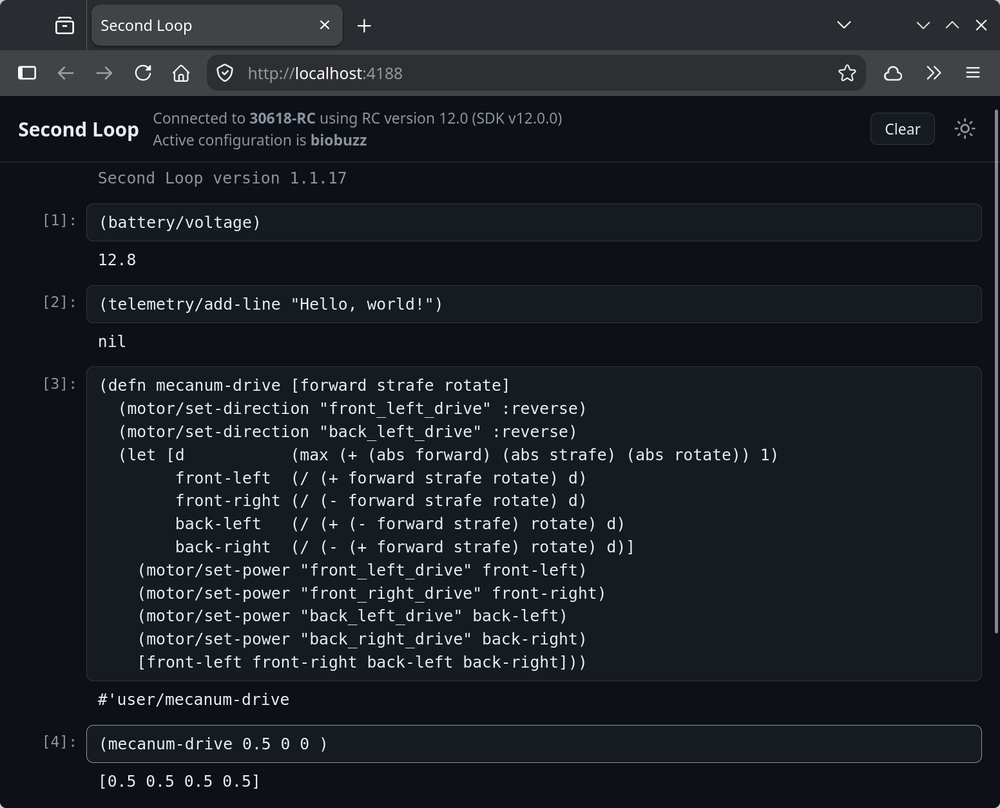

# Second Loop

**Second Loop** is a live coding environment for your
[FTC robot](https://www.firstinspires.org/programs/ftc/), built for rapid
iteration.

Setup takes [just 5 minutes](https://secondloop.io/setup) and needs no Java
coding.

Run [`secondloop.py`](secondloop.py) on your laptop. It opens the
[Notebook](https://secondloop.io/notebook) in your web browser. Type a command
in the box at the bottom of the page and press `Enter`. The command runs on the
robot **right away**, and the result appears below it:

```clojure
user=> (battery/voltage)
12.84
user=> (motor/set-power "flywheel" 0.8)
0.8
```



Want to tune the launcher PID, tweak the drivetrain, or fix the odometry?
Change it while the robot runs and see the result instantly, with **no waiting** to
rebuild, redeploy, and restart.

See the [documentation](https://secondloop.io) for the full manual.
