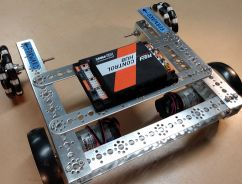

# Robot Heading

The Control Hub has a built-in [IMU](../robot/imu.md), a sensor that tells
which way the robot faces. This example shows the heading on the Driver Hub,
in degrees, while you turn the robot by hand.

{ align=right }

The IMU measures the hub, not the robot, so first tell it how the hub is
mounted: which way the REV logo faces, then which way the USB ports face.

In the picture, the hub lies flat with the REV logo facing up (`:up`), and the
USB ports face the back of the robot (`:backward`):

```clojure
user=> (imu/init :up :backward)
nil
```

If your hub is mounted differently, change the two values to match. The
[IMU](../robot/imu.md#init) page lists all of them.

Point the robot the way headings should be measured from, and make that 0:

```clojure
user=> (imu/reset-yaw)
nil
```

Now show the heading on the telemetry:

```clojure
(defn show-heading []
  (loop []
    (let [degrees (Math/toDegrees (imu/yaw))]  ; radians to degrees
      (telemetry/clear)
      (telemetry/add-line (format "Heading %6.1f°" degrees)))
    (time/sleep 0.1)
    (recur)))
```

Paste it, then run `(show-heading)`. Turn the robot a quarter turn to the left
by hand, and the Driver Hub shows something like:

```
Heading   89.7°
```

Turning left (counter-clockwise) increases the heading, and turning right
decreases it, from -180° to 180°. The loop keeps going until you press STOP on
the Driver Hub.

Next, add a motor and spin a [launcher](launcher.md).
