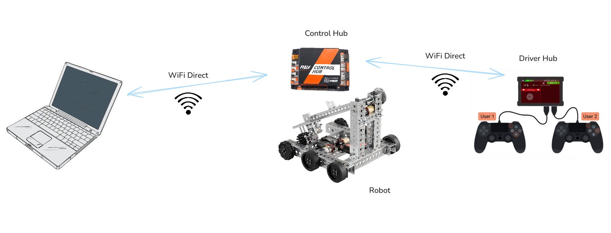

---
hide:
  - title
---

**Second Loop** is a live coding environment for your
[FTC robot](https://www.firstinspires.org/programs/ftc/), built for rapid
iteration.

Setup takes [just 5 minutes](setup.md), with no Java coding.
You talk to the robot from your laptop, and it acts on each command **right
away**.

Want to tune the launcher PID, debug AprilTag detection, or fix the odometry? Change it while the robot runs and see the result instantly, with **no waiting** to
rebuild, redeploy, and restart.

You try ideas and tune your robot much faster, and get more out of every
practice session.

{ width="850" }

Once Second Loop is running, the telemetry on the Driver Hub shows the address
to connect to:

```
Ready at 192.168.43.1:9001 (0 clients)
```

Now run `secondloop.py` on the computer. It should detect the setup
automatically:

```console
$ ./secondloop.py
Connected to 30618-RC using RC version 12.0 (SDK v12.0.0)
Active configuration is biobuzz
Second Loop REPL
user=>
```

Type at the `user=>` prompt. Each line runs on the robot as soon as you press
`Enter`, and the result appears below it. Use the arrow keys to edit the line
and to recall earlier ones. To quit, press `Ctrl+D` on an empty line.

!!! info

    History search, the full list of keys, and other details are covered
    in the [REPL](reference/repl.md) reference.

First, ask the robot for its [battery voltage](robot/battery.md):

```clojure
user=> (battery/voltage)
12.84
```

The answer comes from the robot itself, in volts.

Next, show a message on the Driver Hub:

```clojure
user=> (telemetry/add-line "Hello from my computer")
nil
user=> (telemetry/add-line "Battery" (battery/voltage))
nil
```

The messages should appear in the Driver Hub's [telemetry](robot/telemetry.md). They stay there until you clear them:

```clojure
user=> (telemetry/clear)
nil
```

If a [motor](robot/motors.md) is connected, such as a flywheel that launches artifacts, you can
control it from the prompt. Assuming the motor is named `flywheel` in the robot
configuration, this sets its direction and gives it power to spin:

```clojure
user=> (motor/set-direction "flywheel" :reverse)
:reverse
user=> (motor/set-power "flywheel" 0.8)
0.8
```

And this stops it:

```clojure
user=> (motor/set-power "flywheel" 0)
0.0
```

With a [tank drivetrain](https://gm0.org/en/latest/docs/common-mechanisms/drivetrains/tank.html), you can drive the whole robot from the gamepad. Assuming
the two motors are named `left_drive` and `right_drive`, this loop sends each
stick to its own side, fifty times a second:

```clojure
(defn drive-tank []
  (motor/set-direction "left_drive" :reverse)
  (loop []
    (let [pad (gamepad 1)]
      (motor/set-power "left_drive" (- (:left-stick-y pad)))
      (motor/set-power "right_drive" (- (:right-stick-y pad))))
    (time/sleep 0.02)
    (recur)))
```

The two motors face opposite ways, so one of them is reversed. If the robot
spins in place or drives backward, reverse `right_drive` instead of
`left_drive`. Pushing a stick forward gives a negative value, so the loop
negates it.

Paste the code at the prompt, then run it:

```clojure
user=> (drive-tank)
```

That's it: about ten lines of code, and the robot is ready to drive. The loop
keeps going until you press STOP on the Driver Hub.

Next, we move on to a more complex example with a real game loop: driving a
mecanum drivetrain from the prompt, adjusting the driving speed on the fly, and
more.
