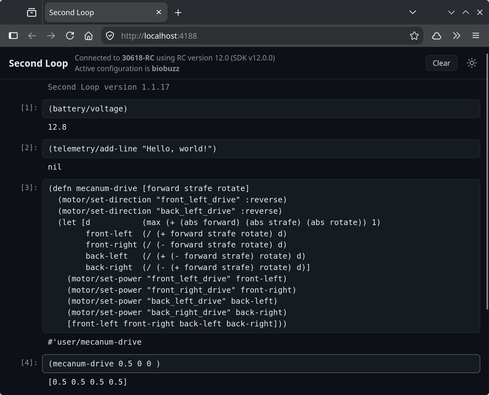

---
hide:
  - title
---

**Second Loop** is a live coding environment for your
[FTC robot](https://www.firstinspires.org/programs/ftc/), built for
rapid iteration.

Setup takes [just 5 minutes](setup.md) and needs no Java coding. You
type commands on your laptop, and the robot runs each one
**right away**. Want to tune the launcher PID, adjust the drivetrain,
or fix the odometry? Change the code **live** and see the results at
once, **without waiting** to rebuild, redeploy, and restart.

Once Second Loop is [running](setup.md), the robot serves the
[Notebook](notebook.md) at `192.168.43.1:9002`. Open it in a web
browser on your laptop, tablet, or phone.

Type a command in the box at the bottom of the page and press `Enter`.
The command runs on the robot right away, and the result appears below
it. Press `Up` and `Down` to bring back earlier commands.

{ .screenshot width="749" }

The examples in this manual are written as a transcript. What you type
comes after `user=>`, and the result appears on the next line.

First, ask the robot for its [battery voltage](robot/battery.md):

```clojure
user=> (battery/voltage)
12.84
```

The answer comes from the robot itself, in volts.

Next, show a few messages in the [telemetry](robot/telemetry.md) on
the Driver Hub:

```clojure
user=> (telemetry/add-line "Hello from my computer")
nil
user=> (telemetry/add-line "Battery" (battery/voltage))
nil
```

From here, the examples build up step by step:
[reading the robot heading](examples/heading.md),
[spinning a launcher motor](examples/launcher.md),
[tuning its PIDF gains](examples/pidf-tuning.md), driving a
[tank](examples/tank-drive.md) or
[mecanum](examples/mecanum-drive.md) drivetrain from the gamepad,
[changing the speed](examples/speed-adjustment.md) while driving, and
[tracking where the robot is](examples/location-tracking.md) on the
field.
