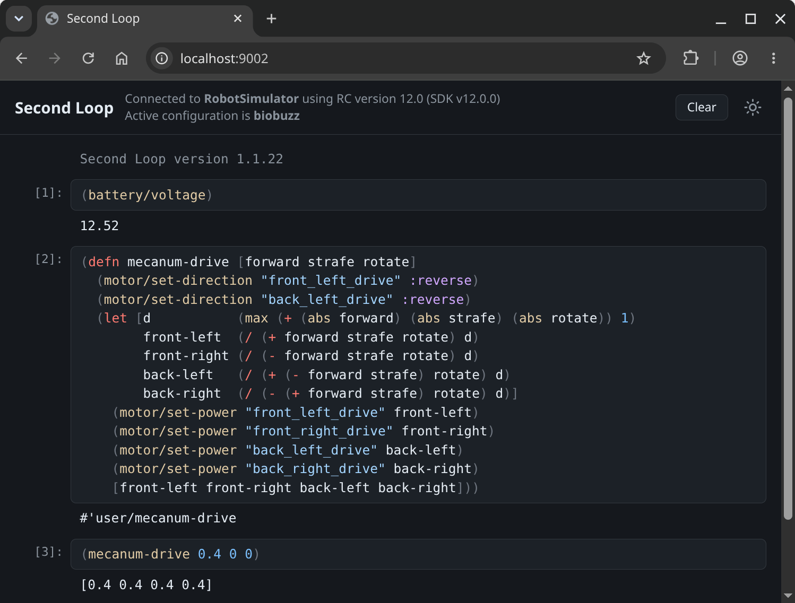

# Notebook

The notebook is where you talk to the robot. It is a page in your web
browser, you type a command, it runs on the robot right away, and the result
appears below it.

{ .screenshot width="880" }

The robot serves the notebook while the Second Loop OpMode runs, as shown in
[Setup](setup.md). Open the address that the Driver Hub shows in its
Second Loop status line, usually <http://192.168.43.1:9002>, in a web browser on a
laptop that is on the robot's WiFi.

Type a command in the box at the bottom of the page and press `Enter`. Each
command you run becomes a cell, with its output below it.

- `Enter` runs the command when its brackets are balanced. If they are not,
  it adds a new line.
- `Shift+Enter` adds a new line.
- `Up` and `Down` bring back earlier commands, when the cursor is on the
  first or last line. The browser keeps them, so they are still there after
  the OpMode restarts.
- `Tab` inserts two spaces.

While a command runs, its cell shows `[*]`. When it finishes, the cell gets a
number. You can't edit earlier cells, but you can click one to copy it into
the input box. Output from a [future](language/futures.md) or a
[task](robot/task.md) appears in the last cell. **Clear** removes all cells.

The examples in this manual are written as a transcript, what you type in the
notebook comes after `user=>`, and the result appears on the next line.

```clojure
user=> (+ 1 2)
3.0
```

The top of the page shows which robot you are connected to and its active
configuration.

If the connection to the robot is lost, the top of the page says so and
shows **Reconnect**. Click it when the robot is back. Your definitions are
still there if the OpMode kept running.

The [REPL](reference/repl.md) reference explains sessions, other clients,
and what to do if the notebook can't connect.
