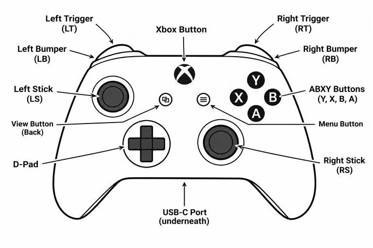

# Gamepad

{ .three-quarters }

`(gamepad 1)` and `(gamepad 2)` each return a snapshot of the controller's
current state as a map. The keys are the FTC SDK's `Gamepad` field names,
written as kebab-case keywords:

| Keys | Values |
| --- | --- |
| `:left-stick-x` `:left-stick-y` `:right-stick-x` `:right-stick-y` | -1.0 to 1.0 |
| `:left-trigger` `:right-trigger` | 0.0 to 1.0 |
| `:a` `:b` `:x` `:y` `:left-bumper` `:right-bumper` | `true` or `false` |
| `:dpad-up` `:dpad-down` `:dpad-left` `:dpad-right` | `true` or `false` |
| `:left-stick-button` `:right-stick-button` | `true` or `false` |
| `:start` `:back` `:guide` | `true` or `false` |

Look up a single key to read one control:

```clojure
user=> (:a (gamepad 1))
false
user=> (:right-trigger (gamepad 1))
0.8
```

To read several controls at once, destructure the map:

```clojure
user=> (let [{:keys [a b x y]} (gamepad 1)] [a b x y])
[true false false true]
```

The same works for the sticks:

```clojure
user=> (let [{:keys [left-stick-x left-stick-y]} (gamepad 1)]
         [left-stick-x left-stick-y])
[0.0 -0.35]
```

The values are passed through exactly as the SDK reports them. As in FTC,
pushing a stick forward gives a *negative* `:left-stick-y`, so negate it to get
a forward motor power. See the threading example in
[Functions](../language/functions.md#threading).

Because each call returns a snapshot, a loop that watches the controller must
call `gamepad` again on every pass. This one shows A, B, X, Y, LT and RT on the
Driver Hub as you press them:

```clojure
(defn show-gamepad []
  (loop []
    (let [pad (gamepad 1)]
      (telemetry/clear)
      (telemetry/add-line "A" (:a pad) "B" (:b pad) "X" (:x pad) "Y" (:y pad))
      (telemetry/add-line (format "LT %.2f  RT %.2f"
                                  (:left-trigger pad) (:right-trigger pad)))
      (time/sleep 0.02)                  ; about 50 snapshots a second
      (recur))))
```

Start it in the background with `(control/start show-gamepad)` and stop it with
`(control/stop)`; see [Control Loops](control-loops.md). While it runs, the
Driver Hub updates as you press buttons:

```
A true B false X false Y false
LT 0.00  RT 0.42
```
