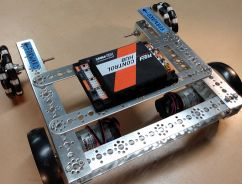

# IMU

The Control Hub has an
[IMU](https://ftc-docs.firstinspires.org/en/latest/programming_resources/imu/imu.html)
(Inertial Measurement Unit), a sensor that tells which way the robot faces.

{ align=right }

Before reading it, tell the IMU how the hub is mounted. For a hub lying flat,
REV logo up, with the USB ports towards the back of the robot:

```clojure
user=> (imu/init :up :backward)
nil
user=> (imu/reset-yaw)
nil
user=> (:yaw (imu/angles))
0.0
```

Angles are in radians, as `Math/sin` and `Math/cos` expect; `Math/toDegrees`
turns one into degrees, and `Math/toRadians` turns degrees back into radians.

## init

`(imu/init logo usb)` tells the IMU how the hub sits on the robot. The IMU
measures the hub, not the robot, so call it once, before the other `imu/*`
functions.

`logo` is the direction the REV logo faces, and `usb` the direction the USB
ports face. Each is one of:

| Value | Faces |
| --- | --- |
| `:up` | Up, towards the ceiling |
| `:down` | Down, towards the floor |
| `:left` | The robot's left side |
| `:right` | The robot's right side |
| `:forward` | The front of the robot |
| `:backward` | The back of the robot |

The logo and the USB ports cannot face along the same axis, such as `:up` and
`:down`; that is an error.

Reading before `imu/init` is an error too, rather than an angle measured the
wrong way round:

```clojure
user=> (imu/angles)
Execution error: The IMU is not set up: first call imu/init with the way the hub is mounted, e.g. (imu/init :up :backward)
```

## reset-yaw

`(imu/reset-yaw)` makes the way the robot faces now the yaw of 0. Call it with
the robot pointing where headings should be measured from, for example at the
start of a match:

```clojure
user=> (imu/reset-yaw)
nil
```

## angles

`(imu/angles)` is a map of `:yaw`, `:pitch` and `:roll`, all read at the same
moment.

`:yaw` is the heading: turning left (counter-clockwise) increases it, from -π
to π (-180° to 180°). `:pitch` is the nose tilting up or down, and `:roll` the
robot leaning to one side. Most programs only need the yaw.

Turn the robot a quarter turn to the left by hand, and the yaw follows. A
quarter turn is π/2, about 1.57 radians; `Math/toDegrees` shows it in degrees:

```clojure
user=> (:yaw (imu/angles))
1.5655603390389137
user=> (Math/toDegrees (:yaw (imu/angles)))
89.7
```

To show it on the Driver Hub, round it too:

```clojure
user=> (telemetry/add-line (format "Yaw %.1f°" (Math/toDegrees (:yaw (imu/angles)))))
nil
```
