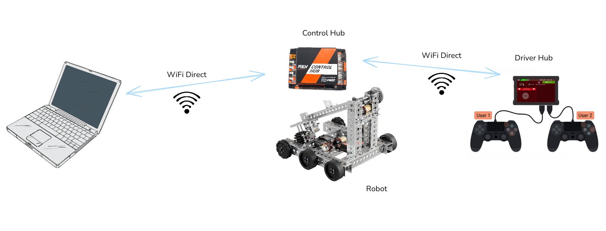

# Setup

{ width="850" }

Second Loop has two parts:

- `SecondLoop.java`, a single OpMode that runs on the robot.
- `secondloop.py`, a small program you run on your laptop to talk to the robot.

You put `SecondLoop.java` on the robot only once. After that, everything you
type on the laptop runs on the robot right away, with no rebuilding.

You need:

- A robot with a REV Control Hub, and a Driver Hub.
- A laptop with Python 3 installed.

While the laptop still has a working Internet connection, download
`SecondLoop.java` and `secondloop.py` from the
[Second Loop repository](https://github.com/ariya/SecondLoop).

Then put `SecondLoop.java` on the robot using **one** of the two methods
below. If you are not sure which one to pick, use OnBot Java: it needs only a
web browser.

## OnBot Java

[OnBot Java](https://ftc-docs.firstinspires.org/en/latest/programming_resources/onbot_java/OnBot-Java-Tutorial.html)
is a code editor built into the robot. You use it from a web browser.

1. Turn on the robot.
2. Connect the laptop to the Control Hub's WiFi (e.g. `30618-RC`).
3. Open `http://192.168.43.1:8080` in a web browser.
4. Click **OnBot Java**.
5. Select the `teamcode` folder.
6. Click **Upload Files** and choose `SecondLoop.java`.
7. Click **Build Everything** and wait for `Build SUCCEEDED!`.

On the Driver Hub, select the **Second Loop** TeleOp and press **INIT**, then
**START**. The telemetry shows the address to connect to:

```
Ready at 192.168.43.1:9001 (0 clients)
```

With the laptop still on the robot's WiFi, open a terminal in the folder where
you saved `secondloop.py` and run it:

```console
$ python3 secondloop.py
Connected to 30618-RC using RC version 12.0 (SDK v12.0.0)
Active configuration is biobuzz
Second Loop REPL
user=>
```

That's it! Head back to the [Overview](index.md) for a first tour, or browse
the [Examples](examples.md).

## Android Studio

Use [Android Studio](https://ftc-docs.firstinspires.org/en/latest/programming_resources/android_studio_java/opmode/opmode.html)
if your team already programs the robot with it. Second Loop then sits next to
your own OpModes.

1. Open your team's robot project in Android Studio.
2. Copy `SecondLoop.java` into `TeamCode/src/main/java/org/firstinspires/ftc/teamcode/`.
3. Connect to the Control Hub via USB or `adb connect 192.168.43.1:5555`.
4. Click **Run** to build and deploy **TeamCode**.
5. Connect the laptop to the Control Hub's WiFi (e.g. `30618-RC`).

On the Driver Hub, select the **Second Loop** TeleOp and press **INIT**, then
**START**. The telemetry shows the address to connect to:

```
Ready at 192.168.43.1:9001 (0 clients)
```

With the laptop still on the robot's WiFi, open a terminal in the folder where
you saved `secondloop.py` and run it:

```console
$ python3 secondloop.py
Connected to 30618-RC using RC version 12.0 (SDK v12.0.0)
Active configuration is biobuzz
Second Loop REPL
user=>
```

That's it! Head back to the [Overview](index.md) for a first tour, or browse
the [Examples](examples.md).
